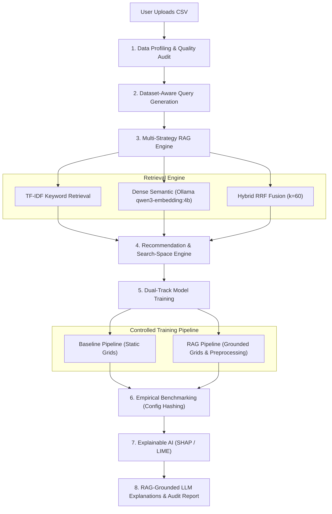

# AI Data Science Assistant

[](https://www.python.org/downloads/)
[](https://streamlit.io/)
[](https://opensource.org/licenses/MIT)
[]()

> **An Intelligent RAG-Guided AutoML & Explainable AI (XAI) Assistant**  
> Bridges Machine Learning domain knowledge, automated dataset profiling, multi-strategy RAG, and rigorous model interpretability into a cohesive, interactive platform.

---

## 🌟 Key Highlights

- **Dynamic RAG-Guided Search Spaces**: Instead of arbitrary hyperparameter tuning grids, the system extracts dataset characteristics (missingness, class imbalance, high-cardinality, sample size) and retrieves grounded algorithmic guidance to construct targeted search spaces.
- **Multi-Strategy Retrieval & Benchmarking**:
  - **Sparse TF-IDF Retrieval**: Exact token matching over curated machine learning documents.
  - **Dense Semantic Retrieval**: High-dimensional embeddings via local Ollama (`qwen3-embedding:4b` or `nomic-embed-text`) with disk caching.
  - **Hybrid RRF (Reciprocal Rank Fusion)**: Combines dense semantics with sparse lexical precision using standard RRF ($k=60$).
- **Controlled, Honest Comparison**: Side-by-side evaluation of Baseline vs. RAG-guided models under identical train/test splits, random seeds, and evaluation metrics, backed by **MD5 configuration hashing** to prove whether RAG actually modified the pipeline.
- **Explainable AI (XAI) with Grounded Mathematical Guardrails**: SHAP (TreeExplainer, LinearExplainer) with mathematical additivity verification ($\sum \phi_i \approx f(x) - E[f(x)]$) and LIME local surrogates.
- **Hallucination-Proof LLM Synthesis**: Local LLMs (`qwen3.5-9b-fast:latest` via Ollama or OpenAI-compatible endpoints) explain SHAP outputs using retrieved literature without being able to invent numerical contributions. Includes full **deterministic fallback** if no LLM is configured.
- **Interactive 16-Step Streamlit Interface**: Guided workflow from dataset upload to interactive EDA, benchmark comparisons, and exportable HTML audit reports.

---

## 🏗️ System Architecture



---

## 📋 Prerequisites

- **Operating System**: Linux, macOS, or Windows
- **Python**: Version `3.10`, `3.11`, `3.12`, or `3.14`
- *(Optional, for local LLM & dense embeddings)*: [Ollama](https://ollama.com/)

---

## 🚀 Quick Start Guide

### 1. Clone the Repository

```bash
git clone https://github.com/<your-username>/ai-data-science-assistant.git
cd ai-data-science-assistant
```

### 2. Create and Activate a Virtual Environment

```bash
# Linux / macOS
python3 -m venv venv
source venv/bin/activate

# Windows (Command Prompt / PowerShell)
python -m venv venv
.\venv\Scripts\activate
```

### 3. Install Dependencies

```bash
pip install --upgrade pip
pip install -r requirements.txt
```

### 4. Configure Environment Variables

Copy the example configuration file:

```bash
cp .env.example .env
```

The application runs **100% offline out-of-the-box** using deterministic TF-IDF retrieval and rule-based explanations. You can configure any LLM provider depending on whether you want an offline or cloud-backed setup:

#### Option A: Offline Local Setup with Ollama (Default)
1. Install [Ollama](https://ollama.com/).
2. Pull the recommended lightweight models:
   ```bash
   ollama pull qwen3.5-9b-fast:latest
   ollama pull qwen3-embedding:4b
   ```
3. Keep the default settings in `.env`:
   ```ini
   LLM_PROVIDER=openai_compatible
   OPENAI_API_KEY=ollama
   OPENAI_BASE_URL=http://localhost:11434/v1
   OPENAI_MODEL=qwen3.5-9b-fast:latest
   EMBEDDING_MODEL=qwen3-embedding:4b
   LLM_ALLOW_REMOTE_DATA=false
   ```

#### Option B: Cloud OpenAI API (GPT-4o, GPT-4o-mini, etc.)
If you prefer not to run local models and have an OpenAI API key:
```ini
LLM_PROVIDER=openai
OPENAI_API_KEY=sk-proj-your-openai-api-key-here
OPENAI_BASE_URL=https://api.openai.com/v1
OPENAI_MODEL=gpt-4o-mini
LLM_ALLOW_REMOTE_DATA=true
```

#### Option C: Google Gemini API (via OpenAI-Compatible Endpoint)
You can use any Google Gemini model with a free API key from [Google AI Studio](https://aistudio.google.com/):
```ini
LLM_PROVIDER=openai_compatible
OPENAI_API_KEY=AIzaSy-your-google-gemini-key-here
OPENAI_BASE_URL=https://generativelanguage.googleapis.com/v1beta/openai/
OPENAI_MODEL=gemini-1.5-flash
# or gemini-2.0-flash, gemini-1.5-pro
LLM_ALLOW_REMOTE_DATA=true
```

#### Option D: Other OpenAI-Compatible Providers (Groq, Together AI, Mistral, vLLM)
Any provider supporting the OpenAI `/v1/chat/completions` schema works seamlessly:
```ini
LLM_PROVIDER=openai_compatible
OPENAI_API_KEY=your-api-key-here
OPENAI_BASE_URL=https://api.groq.com/openai/v1  # Example for Groq
OPENAI_MODEL=llama-3.3-70b-versatile
LLM_ALLOW_REMOTE_DATA=true
```

> **Note on Remote Data**: When using remote cloud providers (OpenAI, Google Gemini, Groq, etc.), set `LLM_ALLOW_REMOTE_DATA=true` so the query generator has permission to use dataset-derived metadata for retrieval enhancement.

### 5. Launch the Streamlit App

```bash
streamlit run app.py
```

The application will open in your browser at `http://localhost:8501`.

---

## 🧪 Running the Test Suite

The project includes 193 unit and integration tests covering data profiling, retrieval strategies, recommendation evaluation, and model training:

```bash
# Run all tests
pytest tests/ -v

# Run with coverage report
pytest tests/ --cov=src --cov-report=term-missing
```

*Note: All tests run deterministically against synthetic datasets without requiring an internet connection or running LLM.*

---

## 📂 Project Structure

```
ai-data-science-assistant/
├── app.py                          # 16-section interactive Streamlit dashboard
├── config/
│   └── settings.py                 # Central system configuration & defaults
├── datasets/                       # Sample benchmark datasets (Titanic, Adult, Marketing)
├── knowledge_base/                 # Curated Markdown knowledge base on ML theory & techniques
│   ├── categorical_encoding.md     # Encoding strategies & cardinality management
│   ├── class_imbalance.md          # Loss reweighting, thresholding, resampling
│   ├── cross_validation.md         # Stratified K-Fold, fold sizing, leakage prevention
│   ├── decision_tree.md            # Criterion, tree depth, sample constraints
│   ├── evaluation_metrics.md       # Balanced accuracy, F1, ROC-AUC, PR-AUC
│   ├── explainable_ai.md           # SHAP vs LIME mathematical foundations
│   ├── high_cardinality.md         # Rare category grouping, target encoding
│   ├── hyperparameter_tuning.md    # Grid search, regularization spectrums
│   ├── logistic_regression.md      # Solvers, penalty norms, inverse regularization C
│   ├── missing_values.md           # Mean, median, mode imputation trade-offs
│   ├── random_forest.md            # Subsampling decorrelation, ensemble sizing
│   └── regression.md               # Linear, Ridge, Huber, evaluation metrics
├── src/
│   ├── data/                       # Ingestion, profiling, type inference, validation
│   ├── llm/                        # Local & OpenAI completion providers with fallback
│   ├── ml/                         # Training pipeline, baseline grids, comparison engine
│   ├── rag/                        # TF-IDF, dense embedding, and hybrid RRF retrievers
│   ├── reporting/                  # Session audit log and HTML/PDF report generators
│   ├── visualization/              # Interactive Plotly dark-themed visualizers
│   └── xai/                        # SHAP (Tree/Linear/Kernel) & LIME explanations
├── tests/                          # Comprehensive pytest test suite (193 tests)
├── .env.example                    # Sample environment configuration template
├── requirements.txt                # Production dependency list
└── README.md                       # Documentation
```

---

## 📊 End-to-End Workflow (The 16 Sections)

| Step | Module | Functionality |
| :---: | :--- | :--- |
| **1–4** | **Data Ingestion & EDA** | Upload any CSV/TSV, inspect shape, summary stats, distributions, missingness patterns, and cardinality. |
| **5** | **Problem Detection** | Automatic problem classification (Binary / Multi-class Classification, Regression). |
| **6** | **RAG Retrieval Benchmark** | Compare TF-IDF, Dense Semantic, and Hybrid RRF retrievers side-by-side with rank fusion diagnostics. |
| **7** | **Recommendations** | Traceable preprocessing and tuning recommendations linked directly to knowledge documents. |
| **8–9** | **Model & Search Space** | Select candidate models (Logistic, Ridge, Decision Tree, Random Forest, HistGradientBoosting) and inspect Baseline vs. RAG-guided search grids. |
| **10–11** | **Training & Evaluation** | Leakage-free `Pipeline` cross-validation with `GridSearchCV`, confusion matrices, ROC/PR curves. |
| **12** | **Baseline vs. RAG Audit** | Side-by-side comparison table, % delta improvements, and MD5 configuration hashes. |
| **13–14**| **Global & Local XAI** | Summary feature importance bar charts, observation-level SHAP waterfall / force plots. |
| **15** | **Grounded LLM Synthesis** | Hallucination-proof natural language explanation connecting local SHAP contributions to retrieved ML literature. |
| **16** | **Download Audit Report** | Export a standalone HTML session report detailing all data characteristics, configurations, and results. |

---

## 💡 Measured Performance Gains

| Dataset | Problem Characteristic | Baseline Model | RAG-Guided Model | Empirical Gain |
| :--- | :--- | :--- | :--- | :--- |
| **Bank Marketing** (`45,211` rows) | Severe Class Imbalance (11.7% positive) | Balanced Acc: `0.7015`<br>ROC-AUC: `0.7015` | Balanced Acc: **`0.8326`**<br>ROC-AUC: **`0.8653`** | **+13.1 pp** Balanced Accuracy<br>**+16.4 pp** ROC-AUC via `class_weight='balanced'` |
| **Adult Census** (`32,561` rows) | High-Cardinality Categoricals | Accuracy: `0.8140` | Accuracy: **`0.8548`** | **+4.1 pp** Accuracy via top-15 frequency capping & criterion tuning |

---

## 🔒 Privacy & Local Execution

- **Zero Cloud Leakage by Default**: When configured with Ollama, no data, metadata, or queries ever leave your machine.
- **Remote Data Guard**: Remote API endpoints will reject sending dataset metadata unless explicitly opted in via `LLM_ALLOW_REMOTE_DATA=true`.

---

## 🤝 Contributing

Contributions are welcome! Please feel free to open an issue or submit a pull request:

1. Fork the Project
2. Create your Feature Branch (`git checkout -b feature/AmazingFeature`)
3. Commit your Changes (`git commit -m 'Add some AmazingFeature'`)
4. Run tests to ensure 100% pass rate (`pytest tests/`)
5. Push to the Branch (`git push origin feature/AmazingFeature`)
6. Open a Pull Request

---

## 📜 License

Distributed under the MIT License. See `LICENSE` for more information.
